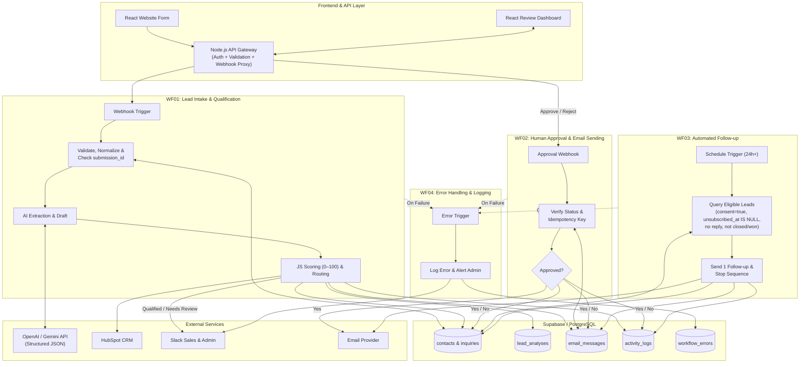
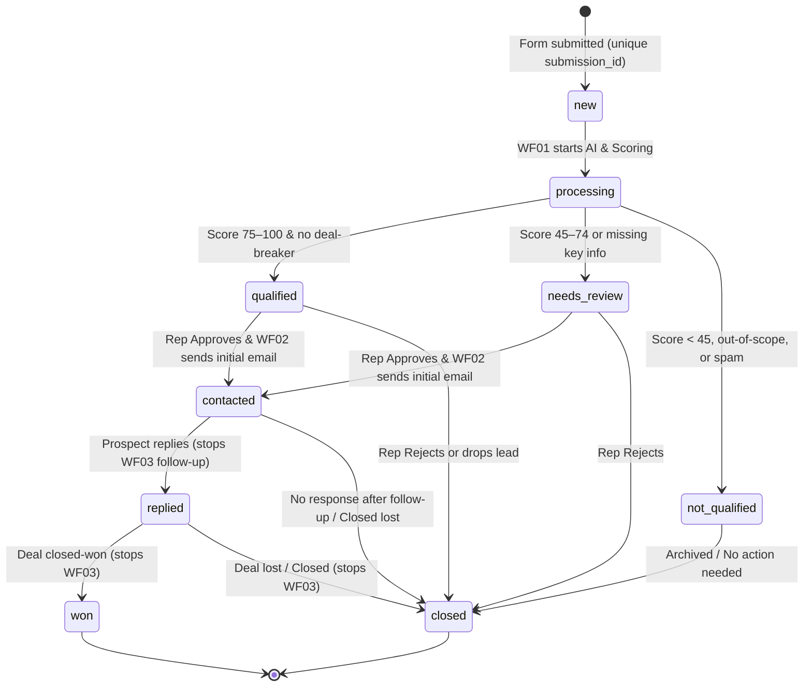

# Data Flow & Lead State Machine — LeadFlow AI

> Aligned with `LeadFlowAI.sql` (database schema & status enums) and `01-business-context.md` (business rules & 75/45 scoring thresholds).

## 1. System Architecture & Workflow Data Flow

## 2. Lead Lifecycle State Machine (`inquiries.lead_status`)

### Parallel State Dimensions (per `LeadFlowAI.sql`)

- **`inquiries.approval_status`:** `not_required` → `pending` → `approved` | `rejected`
- **`inquiries.followup_status`:** `not_eligible` → `scheduled` → `sent` | `stopped`
- **`email_messages.status`:** `draft` → `pending_approval` → `approved` → `queued` → `sent` | `failed` | `cancelled`
- **`inquiries.unsubscribed_at`:** Tracked independently of `lead_status`. Setting `unsubscribed_at` immediately transitions `followup_status` to `stopped` and excludes the lead from WF03 without forcing `lead_status` to `closed`.
