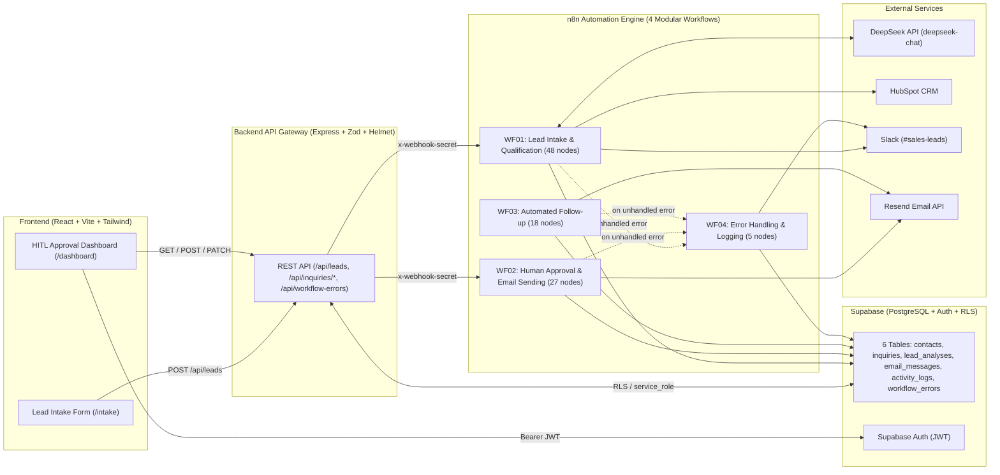

# LeadFlow AI — AI-Powered Lead Qualification & CRM Automation

> Production-grade **n8n + AI + Full-Stack** lead management automation built for **Veloce Digital** (a simulated 12-person boutique web & software studio).
> Automates website inquiry intake, validation, deduplication, structured AI qualification, deterministic scoring, HubSpot CRM synchronization, Slack sales alerting, **Human-in-the-Loop (HITL)** email approval, conditional follow-up, and centralized error handling.

**Stack:** `n8n` · `DeepSeek (deepseek-chat, provider-agnostic)` · `React + TypeScript + Tailwind CSS` · `Node.js + Express + Zod` · `Supabase (PostgreSQL + Auth + RLS)` · `HubSpot CRM` · `Resend` · `Slack` · `Vitest`

**Verification Status:** **`20 / 20` End-to-End Tests PASS** (`15 / 15` automated Vitest integration tests + `5 / 5` manual form harness scenarios, Dual API + DB verified — see [E2E Test Report](tests/reports/e2e-report.md)).

---

## 1. Business Problem & Core Design Principles

Service agencies receive daily website inquiries with inconsistent budgets, unclear scopes, duplicates, and spam. Manual triage slows down response times on high-value leads while risking off-brand or premature automated emails.

**LeadFlow AI** solves this with four non-negotiable engineering guarantees:

1. **AI vs. Deterministic Split:** The LLM (**DeepSeek `deepseek-chat`** in JSON Mode, provider-agnostic per [ADR-007](docs/DECISIONS.md)) performs **semantic extraction, spam detection, and email drafting only**. Deterministic JavaScript (`n8n/code-nodes/score-lead.js`) computes the 0–100 score, deal-breaker overrides, qualification status, and priority. The LLM never computes the final score and never sends customer emails.
2. **Schema Gate Before Database Write:** Every incoming request is validated by **Zod** in Express and re-validated in n8n; every LLM JSON output passes a strict deterministic JS schema gate (`n8n/code-nodes/validate-ai-output.js`) before any write to Supabase.
3. **Human-in-the-Loop (HITL) Approval:** Qualified and Needs Review leads generate an editable operational draft in `email_messages` (`status = 'pending_approval'`). Outbound customer emails are delivered **only after explicit human approval** from an authenticated reviewer on the React Dashboard.
4. **Action-Level Idempotency & Fault Isolation:** Unique `inquiries.submission_id`, normalized email contact upserts (`LOWER(TRIM(email))`), unique `email_messages.idempotency_key` paired with Resend's `Idempotency-Key` header, and a dedicated Error Trigger workflow (`WF04`) prevent duplicate inquiries, duplicate CRM contacts, or double-sent emails during retries.

---

## 2. System Architecture



---

## 3. Modular n8n Workflows (`n8n/workflows/`)

All four workflows are stored as **sanitized, version-controlled JSON** with placeholder credential IDs and zero embedded secrets, deployed via the official n8n Public REST API (`n8n/scripts/sync-workflows.ts`):

| Workflow | File | Nodes | Trigger | Responsibilities |
|---|---|---|---|---|
| **WF01 — Lead Intake & Qualification** | [wf01-lead-intake-qualification.json](n8n/workflows/wf01-lead-intake-qualification.json) | 48 | Webhook (`POST /webhook/lead-intake`, Header Auth) | Validate & normalize payload, enforce `submission_id` idempotency, upsert `contacts`, call DeepSeek `deepseek-chat`, enforce strict JS schema gate, compute deterministic score (0–100 + overrides), save `lead_analyses` & operational `email_messages` draft, upsert HubSpot contact, send Slack Block Kit alert (`[HIGH PRIORITY]` / `[NEEDS REVIEW]`). |
| **WF02 — Human Approval & Email Sending** | [wf02-human-approval-email.json](n8n/workflows/wf02-human-approval-email.json) | 27 | Webhook (`POST /webhook/lead-approval`, Header Auth) | Verify pending approval state, handle **Approve** (persist optional subject/body edits, send via Resend with `Idempotency-Key: email:<inquiry_id>:initial`, save `provider_message_id` & `sent_at`, transition lead to `contacted` + `followup_status='scheduled'`) or **Reject** (`cancelled` draft, `closed` lead, zero email sent). |
| **WF03 — Automated Follow-up** | [wf03-automated-followup.json](n8n/workflows/wf03-automated-followup.json) | 18 | Schedule Trigger (hourly) | Query `followup_status='scheduled'` leads, apply deterministic stop rules (`unsubscribed_at`, `consent_to_email=false`, `replied`/`closed`/`won`), reconcile partial failures, send at most **1** follow-up 24h+ after initial send using `email:<inquiry_id>:follow_up_1` idempotency lock (cap 25/run). |
| **WF04 — Error Handling & Logging** | [wf04-error-handling.json](n8n/workflows/wf04-error-handling.json) | 5 | Error Trigger (`errorWorkflow` on WF01–WF03) | Normalize error context, redact bearer tokens/API keys/JWTs, insert record into `public.workflow_errors`, and send `[WORKFLOW ERROR]` Slack admin alert (with `continueErrorOutput` fallback so Slack still alerts even if Supabase is unreachable). |

---

## 4. Database Schema, RLS & Scoring Rubric

### PostgreSQL Schema (`database/`)
- **Core DDL:** [database/schema/LeadFlowAI.sql](database/schema/LeadFlowAI.sql) (6 normalized tables with strict `CHECK` enums and `UNIQUE` idempotency constraints)
- **Additive Migration:** [database/schema/002_score_breakdown_and_triggers.sql](database/schema/002_score_breakdown_and_triggers.sql) (`lead_analyses.score_breakdown JSONB` + automatic `updated_at` triggers per [ADR-004](docs/DECISIONS.md))
- **Security Policies:** [database/policies/001_rls_and_grants.sql](database/policies/001_rls_and_grants.sql) (RLS enabled on **6 / 6 tables**: `anon` has zero table access; `authenticated` sales reviewers read via JWT; `service_role` stays strictly server-side in Express and n8n)

| Table | Role | Key Constraints |
|---|---|---|
| `contacts` | Deduplicated lead contacts | Unique normalized email (`LOWER(TRIM(email))`), `hubspot_contact_id` |
| `inquiries` | Project inquiries & 4-dimension lifecycle states | `UNIQUE(submission_id)`, `lead_status`, `priority`, `approval_status`, `followup_status`, consent & `unsubscribed_at` |
| `lead_analyses` | AI extraction + deterministic score audit | `qualification_score (0–100)`, `score_breakdown JSONB`, immutable `draft_email` snapshot |
| `email_messages` | Operational HITL drafts & delivery audit | `UNIQUE(idempotency_key)`, `UNIQUE(provider_message_id)`, `approved_by`, `sent_at` |
| `activity_logs` | Timeline audit log per inquiry | `event_type`, `event_data JSONB` |
| `workflow_errors` | Centralized n8n failure log | `workflow_name`, `execution_id`, `node_name`, `status ('open' | 'resolved')` |

### Deterministic Scoring Rules (`n8n/code-nodes/score-lead.js`)
- **Service Fit (0–30):** `high` in-scope → 30 · `medium` → 18 · `low` → 5 · `Out of Scope` → 0 *(deal-breaker)*
- **Budget Fit (0–30):** `$5k–$25k` → 30 · `>$25k` → 26 · `$3k–$4,999` → 20 · `$1,500–$2,999` → 10 · undisclosed → 10 *(caps at `needs_review`)* · `<$1,500` → 0 *(deal-breaker)*
- **Timeline Fit (0–20):** `4–16` weeks → 20 · `17–24` or `2–3` weeks → 12 · undisclosed → 8 · `<2` or `>24` weeks → 5
- **Project Clarity (0–20):** `high` (0–1 missing items) → 20 · `medium` → 12 · `low` → 5
- **Classification:** `75–100` → `qualified` (`high`) · `45–74` or missing critical info → `needs_review` (`medium`) · `<45` or deal-breaker (`spam_suspected`, `Out of Scope`, budget `<$1,500`) → `not_qualified` (`low`, no draft email, no Slack alert)

---

## 5. Express API Endpoints (`backend/`)

All endpoints return a standard envelope: `{ "ok": boolean, "data": T | null, "error": { code, message, details? } | null }`.

| Method & Endpoint | Auth | Description |
|---|---|---|
| `GET /api/health` | Public | Health & liveness check |
| `POST /api/leads` | Public (Zod + rate-limit) | Validate lead intake payload, generate `submission_id` if omitted, proxy to n8n `WF01` |
| `GET /api/inquiries` | Supabase Bearer JWT | List inquiries with contact, latest AI analysis, and filters (`status`, `priority`, `approval_status`) |
| `GET /api/inquiries/:id` | Supabase Bearer JWT | Inquiry details including score breakdown, `email_messages`, and `activity_logs` |
| `POST /api/inquiries/:id/approve` | Supabase Bearer JWT | Approve pending draft (with optional subject/body edits) and trigger n8n `WF02` |
| `POST /api/inquiries/:id/reject` | Supabase Bearer JWT | Reject pending draft (with optional reason) and trigger n8n `WF02` |
| `PATCH /api/inquiries/:id/status` | Supabase Bearer JWT | Update lifecycle (`replied`, `closed`, `won`, or `unsubscribed: true` to stop follow-ups) |
| `GET /api/workflow-errors` | Supabase Bearer JWT | Operational log of `workflow_errors` (`?status=open|resolved`) |

---

## 6. Repository Structure

```text
LeadFLowAI/
├── backend/                  # Express + TypeScript API Gateway (Zod, Helmet, Supabase Auth)
├── frontend/                 # React + TypeScript + Vite + Tailwind CSS + Recharts Dashboard
├── database/
│   ├── schema/               # LeadFlowAI.sql (6 tables) + 002_score_breakdown_and_triggers.sql
│   └── policies/             # 001_rls_and_grants.sql (strict RLS on all 6 tables)
├── n8n/
│   ├── workflows/            # Sanitized WF01–WF04 JSON definitions (zero secrets)
│   ├── code-nodes/           # Standalone JS modules (normalize, schema gate, scoring, follow-up)
│   ├── prompts/              # Provider-agnostic qualification prompt
│   └── scripts/              # sync-workflows.ts (n8n Public REST API deployer)
├── test-data/                # mock-leads.json (12 realistic scenarios TC01–TC12)
├── tests/
│   ├── scripts/              # 15 automated Vitest integration tests + helpers
│   ├── reports/              # e2e-report.md (20/20 verified test results)
│   └── test-form.html        # Semi-automated manual test harness
└── docs/
    ├── architecture/         # Business context, dataflow/states, API & RLS contract
    ├── portfolio/            # Upwork Portfolio case study (EN & VI)
    ├── DECISIONS.md          # ADR-001 through ADR-010
    ├── PROJECT_STATUS.md     # 14-day roadmap & handover tracker
    └── TESTING_STRATEGY.md   # Hybrid testing specification
```

---

## 7. Quick Start & Local Setup

### Prerequisites
- **Node.js** `>= 22` (used for built-in `--env-file` & TypeScript tooling)
- **Local n8n instance** running on `http://localhost:5678` (Docker or npm) with Public API enabled
- **Accounts / API Keys:** Supabase project, DeepSeek API key (or OpenAI/Gemini if swapping the LLM node), HubSpot Private App token, Resend API key, Slack Bot token (`#sales-leads`)

### Step 1 — Initialize Supabase Database & Reviewer Account
1. Open your Supabase project's **SQL Editor** and run in order:
   1. `database/schema/LeadFlowAI.sql`
   2. `database/schema/002_score_breakdown_and_triggers.sql`
   3. `database/policies/001_rls_and_grants.sql`
2. Under **Supabase Auth → Users**, create at least one sales reviewer account (email + password) for logging into the Approval Dashboard.

### Step 2 — Configure Environment Variables
Copy the three templates and fill in your local credentials (never commit `.env` files):

```powershell
Copy-Item .env.example .env
Copy-Item backend/.env.example backend/.env
Copy-Item frontend/.env.example frontend/.env
```

> **Security Rule:** `frontend/.env` MUST contain only `VITE_API_BASE_URL`, `VITE_SUPABASE_URL`, and `VITE_SUPABASE_ANON_KEY`. Never place `SUPABASE_SERVICE_ROLE_KEY`, `N8N_WEBHOOK_SECRET`, or third-party API keys in `frontend/`.

### Step 3 — Configure n8n Credentials & Import Workflows
Create the following **6 credentials** in n8n UI (matching the sanitized names in `n8n/workflows/*.json`):

| n8n Credential Name | Type | Configuration |
|---|---|---|
| `x-webhook-secret` | Header Auth | Header Name: `x-webhook-secret`, Value: matches `N8N_WEBHOOK_SECRET` |
| `Supabase LeadFlow` | Supabase API | Project Host (`https://<ref>.supabase.co`) + `service_role` key |
| `DeepSeek LeadFlow` | DeepSeek API (`deepSeekApi`) | `DEEPSEEK_API_KEY` |
| `HubSpot Service Key account` | HubSpot App Token | Private App token with `crm.objects.contacts.read` & `crm.objects.contacts.write` |
| `Slack LeadFlow` | Slack API (`slackApi`) | Bot Token (`chat:write`) invited to `#sales-leads` |
| `Resend LeadFlow` | Bearer Auth (`httpBearerAuth`) | `RESEND_API_KEY` |

Install dependencies and sync/verify workflows via the n8n REST API:

```powershell
npm install
npm --prefix backend install
npm --prefix frontend install

# Verify connectivity to local n8n
npm run n8n:check

# Push workflows (or import n8n/workflows/wf01–wf04*.json via n8n UI)
node --env-file=.env n8n/scripts/sync-workflows.ts --push
```

After importing, bind your credentials in each workflow, set **Workflow Settings → Error Workflow = `WF04 - Error Handling & Logging`** on `WF01`, `WF02`, and `WF03` (leave empty on `WF04`), and activate all 4 workflows.

### Step 4 — Run Backend & Frontend

```powershell
# Terminal 1 — Express API Gateway (http://localhost:4000)
npm --prefix backend run dev

# Terminal 2 — React Lead Intake & Approval Dashboard (http://localhost:5173)
npm --prefix frontend run dev
```

- **Public Lead Intake Form:** `http://localhost:5173/`
- **Sales Reviewer Login:** `http://localhost:5173/login`
- **Human Approval Dashboard:** `http://localhost:5173/dashboard`
- **Manual Test Harness:** open `tests/test-form.html` directly in your browser (pre-configured for `http://localhost:4000/api/leads`)

---

## 8. Testing & Verification Results

LeadFlow AI uses a **Hybrid Testing Strategy** ([docs/TESTING_STRATEGY.md](docs/TESTING_STRATEGY.md)) enforcing the **Dual Verification Rule** — every test verifies **both** the HTTP API response and the resulting PostgreSQL database state, then tears down uniquely prefixed synthetic records in strict FK order.

| Verification Suite | Scope | Result |
|---|---|---|
| TypeScript Checks (`npm run typecheck`) | `backend` + `frontend` (`tsc --noEmit`) | **PASS** (0 errors) |
| Frontend Secret Leak Scan | `frontend/src/**` & `frontend/.env*` | **PASS** (0 secrets) |
| n8n Sanitization Audit (`leadflow-n8n-sanitize`) | `WF01`–`WF04` JSON + live parity | **PASS** (4/4 clean & `[ACTIVE]`) |
| Automated Vitest Integration Suite (`npm test`) | 3 suites (`IT-01`–`IT-15`): validation, Auth/RLS, AI qualification, deterministic scoring, dedup, HITL approve/reject, replay protection, WF03 stop rules, WF04 error isolation | **PASS (`15 / 15` in `48.09s`)** |
| Manual `test-form.html` Harness | 5 scenarios (`MT-01`–`MT-05`) | **PASS (`5 / 5`)** |
| Post-Test DB Teardown | FK-safe cleanup across all 6 tables | **PASS (`0` residual rows)** |

Full test evidence is documented in [tests/reports/e2e-report.md](tests/reports/e2e-report.md).

```powershell
# Re-run typechecks and full 15-test Vitest integration suite locally
npm run typecheck
npm test
```

---

## 9. 60–90 Second Demo Video Walkthrough

Use this sequence to showcase the complete end-to-end flow:

1. **`0:00–0:15` — Lead Intake (`/`)**: Submit a high-fit B2B SaaS MVP inquiry (`$12k–$18k`, 10 weeks, `consent_to_email = true`) on the Veloce Digital form (or `tests/test-form.html` preset `TC01`).
2. **`0:15–0:30` — n8n WF01 + HubSpot + Slack**: Show `WF01` execution completing (DeepSeek extraction → deterministic JS scoring → Supabase insert → HubSpot contact upsert → `[HIGH PRIORITY]` Slack Block Kit notification with direct review link).
3. **`0:30–0:55` — Human Approval Dashboard (`/dashboard`)**: Log in with Supabase Auth, open the pending lead, highlight the AI project summary, itemized **Score Breakdown (0–100)**, and editable AI email draft. Click **Approve & Send**.
4. **`0:55–1:15` — WF02 Delivery + Audit Trail**: Show `WF02` dispatching the email via Resend with `Idempotency-Key`, transitioning the inquiry to `contacted` / `approved` / `followup_status = scheduled`, and recording the immutable `activity_logs` timeline.
5. **`1:15–1:30` — Resilience & Test Proof**: Briefly flash `WF03` (24h conditional follow-up + stop rules), `WF04` (error logging + Slack admin alert), and the **`20 / 20 PASS`** E2E report.

---

## 10. Documentation Index

- [Architectural Decision Records (ADR-001 – ADR-010)](docs/DECISIONS.md)
- [Business Context & Scoring Rules](docs/architecture/01-business-context.md)
- [Dataflow & 4-Dimension Lead States](docs/architecture/02-dataflow-and-states.md)
- [API, AI Schema & RLS Contract](docs/architecture/03-api-and-rls-contract.md)
- [End-to-End Test Report (20/20 PASS)](tests/reports/e2e-report.md)
- [Upwork Portfolio Case Study (English)](docs/portfolio/LeadFlow_AI_Upwork_Portfolio_EN.md) · [Vietnamese](docs/portfolio/LeadFlow_AI_Upwork_Portfolio.md)
