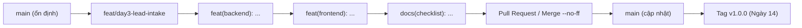

# Quy trình sử dụng Git — LeadFlow AI

Tài liệu này quy định quy trình làm việc với Git cho dự án **LeadFlow AI** (lộ trình 14 ngày & Upwork Portfolio). Dự án áp dụng mô hình **GitHub Flow tinh gọn** kết hợp **Conventional Commits** để giữ lịch sử commit rõ ràng, dễ kiểm soát và an toàn thông tin nhạy cảm.

---

## 1. Mô hình phân nhánh (Branching Strategy)



- **`main`:** Nhánh chính, **luôn ở trạng thái sạch và chạy được**. Không code trực tiếp các thay đổi lớn lên `main`.
- **Nhánh công việc (Feature / Fix / Test / Docs):** Mỗi ngày hoặc mỗi module tách 1 nhánh ngắn từ `main`. Sau khi hoàn thành và kiểm thử xong thì merge vào `main` rồi xóa nhánh cũ.

### Quy ước đặt tên nhánh

Format: `<prefix>/<ngay-hoac-ten-ngan-kebab-case>`

| Tiền tố | Mục đích | Ví dụ trong LeadFlow AI |
|---|---|---|
| `feat/` | Tính năng mới hoặc workflow mới | `feat/day3-lead-intake`, `feat/day5-ai-qualification` |
| `fix/` | Sửa lỗi logic, bug UI/API hoặc lỗi workflow | `fix/wf01-invalid-ai-json` |
| `test/` | Viết script kiểm thử, bổ sung test case & report | `test/day13-e2e-report` |
| `docs/` | Viết tài liệu, README, sơ đồ, portfolio | `docs/day14-portfolio-handover` |
| `chore/` | Cấu hình dự án, `.gitignore`, dọn dẹp cấu trúc | `chore/setup-env-examples` |

### Gợi ý tên nhánh theo lộ trình 14 ngày

- Ngày 3: `feat/day3-lead-intake`
- Ngày 4: `feat/day4-validation-dedup`
- Ngày 5: `feat/day5-ai-qualification`
- Ngày 6: `feat/day6-lead-scoring`
- Ngày 7: `feat/day7-hubspot-sync`
- Ngày 8: `feat/day8-slack-alerts`
- Ngày 9: `feat/day9-approval-dashboard`
- Ngày 10: `feat/day10-email-automation`
- Ngày 11: `feat/day11-followup-wf03`
- Ngày 12: `feat/day12-error-handling-wf04`
- Ngày 13: `test/day13-e2e-report`
- Ngày 14: `docs/day14-portfolio-handover`

---

## 2. Quy ước Commit (Conventional Commits)

Format chuẩn:

```text
<type>(<scope>): <mô tả ngắn gọn, dùng động từ nguyên thể tiếng Anh>
```

### Danh sách `type`

| Type | Khi nào dùng |
|---|---|
| `feat` | Thêm tính năng, endpoint, màn hình UI hoặc workflow mới |
| `fix` | Sửa lỗi |
| `docs` | Chỉ thay đổi tài liệu, README, checklist |
| `test` | Thêm/sửa test case, script test, báo cáo test |
| `refactor` | Tái cấu trúc code mà không đổi hành vi |
| `chore` | Cấu hình, dependency, `.gitignore`, dọn thư mục |

### Danh sách `scope` (khớp cấu trúc thư mục dự án)

- `frontend` — React + TypeScript (`frontend/`)
- `backend` — Node.js API Gateway (`backend/`)
- `n8n` — Workflows, prompts, code-nodes (`n8n/`)
- `database` — Schema SQL, RLS policies, seeds (`database/`)
- `docs` — Tài liệu kiến trúc, cài đặt, portfolio (`docs/`)
- `tests` — Test scripts, mock data, test reports (`tests/`, `test-data/`)

### Ví dụ commit tốt (Atomic Commits)

```text
feat(backend): add authenticated lead intake proxy endpoint
feat(frontend): build Veloce Digital inquiry form
feat(n8n): export sanitized WF01 lead intake workflow
fix(n8n): handle malformed AI JSON response without DB write
test(tests): add duplicate submission_id verification script
docs(docs): mark Day 3 checklist tasks completed
```

> **Nguyên tắc:** Chia commit nhỏ theo từng phần hoàn chỉnh (ví dụ: commit riêng `backend`, riêng `frontend`, riêng `n8n`), tránh gộp tất cả vào một commit mơ hồ như `update code`.

---

## 3. Quy trình thao tác hằng ngày (Daily Git Loop)

### Bước 1 — Bắt đầu công việc mới từ `main`

```powershell
git checkout main
git pull origin main
git checkout -b feat/day3-lead-intake
```

### Bước 2 — Code, kiểm thử và commit nhỏ theo từng phần

```powershell
# Kiểm tra những file đã thay đổi
git status

# Xem lại nội dung thay đổi trước khi stage
git diff

# Stage đúng nhóm file liên quan và commit
git add backend/
git commit -m "feat(backend): add authenticated lead intake proxy endpoint"
```

### Bước 3 — Push nhánh lên GitHub

```powershell
git push -u origin feat/day3-lead-intake
```

### Bước 4 — Merge vào `main` và dọn nhánh cũ

- **Cách 1 (Khuyên dùng cho Portfolio):** Tạo **Pull Request** trên GitHub từ `feat/day3-lead-intake` → `main`, ghi ngắn gọn những gì đã làm & kết quả test, bấm **Merge pull request**, rồi cập nhật lại local:

```powershell
git checkout main
git pull origin main
git branch -d feat/day3-lead-intake
```

- **Cách 2 (Merge nhanh ở local):**

```powershell
git checkout main
git merge --no-ff feat/day3-lead-intake -m "merge: complete Day 3 lead intake"
git push origin main
git branch -d feat/day3-lead-intake
git push origin --delete feat/day3-lead-intake
```

### Bước 5 — Gắn Tag các mốc quan trọng

Khi hoàn thành các mốc lớn (ví dụ xong MVP WF01 hoặc hoàn thiện Portfolio Ngày 14):

```powershell
git tag -a v1.0.0 -m "Release LeadFlow AI v1.0.0 — Complete Upwork Portfolio"
git push origin v1.0.0
```

---

## 4. Quy tắc bảo mật Git & Export n8n (Bắt buộc)

Trước mọi lần `git commit` / `git push`, kiểm tra 4 điểm sau:

1. **Không commit file `.env`:** Chỉ commit `.env.example` với giá trị rỗng hoặc placeholder.
2. **Không để lộ secret trong code hoặc log:** Tuyệt đối không hardcode `SUPABASE_SERVICE_ROLE_KEY`, `N8N_WEBHOOK_SECRET`, OpenAI/Gemini API key, HubSpot token hay Slack Webhook URL.
3. **Làm sạch file JSON n8n trước khi lưu vào `n8n/workflows/`:**
   - Xóa hoặc thay thế các giá trị nhạy cảm (email cá nhân, URL webhook thật, credential ID nội bộ nếu không cần thiết).
   - Đặt tên file nhất quán: `wf01-lead-intake-qualification.json`, `wf02-human-approval-email.json`, `wf03-automated-followup.json`, `wf04-error-handling.json`.
4. **Kiểm tra nhanh file sắp commit:**

```powershell
git status --short
git diff --cached --stat
```

---

## 5. Xử lý nhanh các tình huống thường gặp

| Tình huống | Lệnh xử lý |
|---|---|
| Lỡ `git add .env` (chưa commit) | `git reset HEAD .env` |
| Sửa lại nội dung message của commit gần nhất (chưa push) | `git commit --amend -m "feat(backend): new message"` |
| Hủy thay đổi chưa stage ở 1 file | `git checkout -- <duong-dan-file>` |
| Lỡ bắt đầu sửa file trên `main` (chưa commit) | `git checkout -b feat/ten-nhanh-moi` (Git sẽ mang thay đổi sang nhánh mới) |
| Kiểm tra lịch sử commit dạng cây gọn | `git log --oneline --graph --decorate -n 15` |
